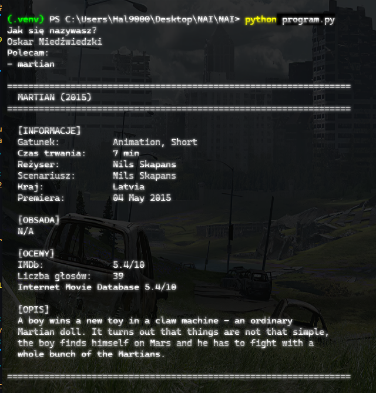
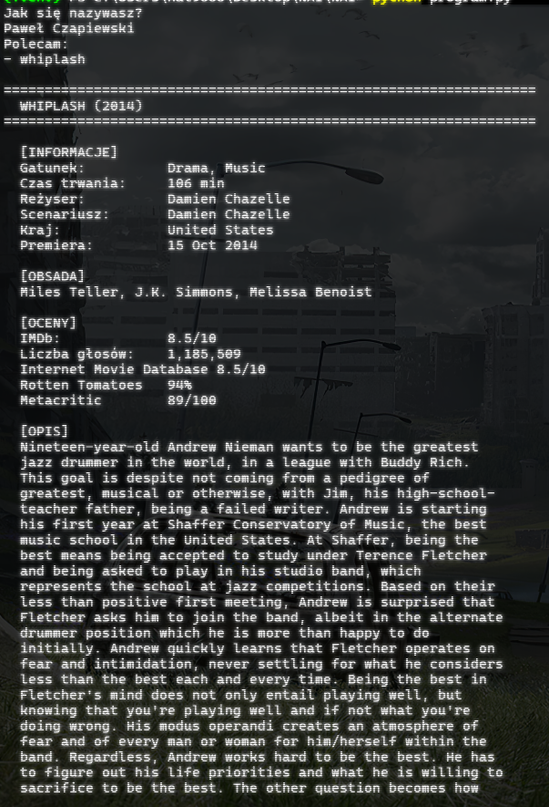

# Run Me
```
    python -m venv .venv
    ./.venv/Scripts/activate
    pip install -r requirements.txt
    python ./program.py
```

## Użycie programu

Program poprosi nas o to jak się nazywamy *Wpisujemy Imię i Nazwisko* swoje  
Przykład: Oskar Niedźwiedzki  
Przykład: Paweł Czapiewski   
Jeśli program nie znajdzie nas w pliku napisze nam że nie ma takiego człowieka w bazie danych

## Propozycje dla Pana Oskara
### Pozytywna

### Negatywna


## Propozycje dla Pana Pawła
### Pozytywna

### Negatywna


